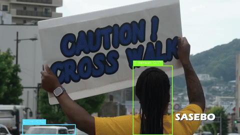
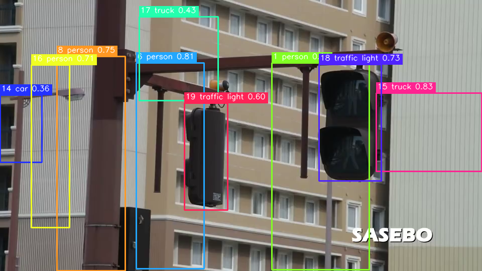
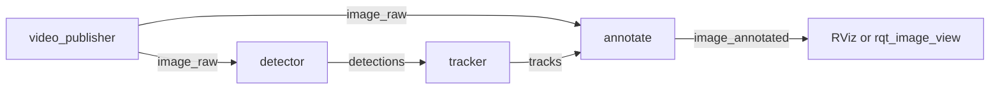

# ROS 2 vision tracking demo

A ROS 2 Humble pipeline that plays a video, detects objects with YOLO, keeps a stable id on each object, and publishes an annotated image. It runs in simulation on a CPU. No camera, GPU, or robot is required.

The tracker is an original ByteTrack-style loop: a constant-velocity Kalman filter, then IoU matching in two stages. High-score detections may start tracks. Low-score detections only extend tracks that the first stage missed. It is not a fork of the SORT or ByteTrack reference repositories.



Still frame from the same clip. Boxes are `track id`, class, and score.



The clip is a short public-domain U.S. Navy video of a crossing guard. See [media/SOURCE.md](media/SOURCE.md).

## Architecture



| Topic | Type | What it carries |
| --- | --- | --- |
| `/image_raw` | `sensor_msgs/Image` | BGR frames from a file or V4L2 device |
| `/detections` | `vision_msgs/Detection2DArray` | YOLO boxes. `id` is empty |
| `/tracks` | `vision_msgs/Detection2DArray` | The same box layout, with `id` set to the track id |
| `/image_annotated` | `sensor_msgs/Image` | Boxes and labels for RViz |

`class_id` on each hypothesis is the class name (`person`, `car`, …). Parameters live in [`src/vision_tracking/config/tracking.yaml`](src/vision_tracking/config/tracking.yaml).

Two detector backends:

- `opencv_dnn` (default). YOLOv4-tiny via OpenCV DNN, which is what ships with Humble. A `.onnx` file is accepted when that OpenCV build can import it.
- `ultralytics`. Optional. `pip install ultralytics`, then pass a `.pt` checkpoint. On a Jetson, `device:=0` uses CUDA. See [docs/jetson.md](docs/jetson.md).

## Quick start

Ubuntu 22.04, or Docker anywhere else. Humble's apt packages target 22.04.

### Docker

```bash
docker build -t vision-tracking-demo .
docker run --rm --network host vision-tracking-demo
```

The image downloads YOLOv4-tiny on build and launches the four nodes against `media/sample_crossing.mp4`. RViz is off. In another terminal on the same machine:

```bash
source /opt/ros/humble/setup.bash
ros2 topic hz /image_annotated
ros2 topic echo /tracks vision_msgs/msg/Detection2DArray
```

With a display:

```bash
docker run --rm --network host \
  -e DISPLAY="$DISPLAY" \
  -v /tmp/.X11-unix:/tmp/.X11-unix \
  vision-tracking-demo \
  ros2 launch vision_tracking tracking_demo.launch.py \
    video_path:=/opt/ws/media/sample_crossing.mp4 \
    model_path:=/opt/ws/models/yolov4-tiny.weights \
    config_path:=/opt/ws/models/yolov4-tiny.cfg \
    rviz:=true
```

`rqt_image_view` is in the image if you only want the annotated topic:

```bash
ros2 run rqt_image_view rqt_image_view /image_annotated
```

### Ubuntu 22.04 without Docker

```bash
sudo apt update
sudo apt install -y \
  python3-colcon-common-extensions python3-opencv python3-numpy python3-pytest \
  ros-humble-cv-bridge ros-humble-vision-msgs ros-humble-message-filters \
  ros-humble-rviz2 ros-humble-rqt-image-view
./scripts/fetch_assets.sh
source /opt/ros/humble/setup.bash
colcon build --packages-select vision_tracking
source install/setup.bash
ros2 launch vision_tracking tracking_demo.launch.py \
  video_path:="$PWD/media/sample_crossing.mp4" \
  model_path:="$PWD/models/yolov4-tiny.weights" \
  config_path:="$PWD/models/yolov4-tiny.cfg" \
  rviz:=true
```

A live camera is the same launch with `video_path:=/dev/video0`. The publisher does not loop device paths.

Ultralytics, after `pip install ultralytics`:

```bash
ros2 launch vision_tracking tracking_demo.launch.py \
  video_path:="$PWD/media/sample_crossing.mp4" \
  backend:=ultralytics \
  model_path:=yolov8n.pt \
  device:=cpu \
  rviz:=false
```

`input_size` stays in the YAML file (416 for YOLOv4-tiny, 640 for YOLOv8).

### GIF without ROS

The renderer imports the same detector and tracker the nodes use. On Ubuntu 24.04 this is the path that does not need Humble:

```bash
sudo apt install -y python3-opencv python3-numpy ffmpeg
./scripts/fetch_assets.sh
python3 scripts/render_demo.py \
  --video media/sample_crossing.mp4 \
  --model models/yolov4-tiny.weights \
  --config models/yolov4-tiny.cfg \
  --output media/demo.gif \
  --still media/demo_frame.png
```

## Tests

Core tests (assignment, Kalman tracker, YOLO decode, video loop) need NumPy, OpenCV, and pytest. They do not download weights.

```bash
cd src/vision_tracking
python3 -m pytest
```

Set `VISION_TRACKING_WEIGHTS` and `VISION_TRACKING_CFG` to also run one forward pass on a blank image.

The Humble job in [`.github/workflows/ci.yml`](.github/workflows/ci.yml) is `colcon build` and `colcon test` inside `ros:humble-ros-base`, including `ament_copyright`, `ament_flake8`, and `ament_pep257`. Message round-trips and node imports run there.

```bash
docker build -t vision-tracking-demo .
docker run --rm -w /opt/ws vision-tracking-demo \
  bash -lc 'colcon test --packages-select vision_tracking --event-handlers console_direct+ && colcon test-result --verbose'
```

## Layout

```
src/vision_tracking/          ament_python package
  vision_tracking/            library and nodes
  launch/tracking_demo.launch.py
  config/tracking.yaml
  rviz/tracking.rviz
scripts/fetch_assets.sh       YOLOv4-tiny cfg and weights
scripts/render_demo.py        GIF renderer, no ROS
docker/entrypoint.sh
```

A dev container is in [`.devcontainer/devcontainer.json`](.devcontainer/devcontainer.json). It builds the Dockerfile, then rebuilds the workspace on the mounted tree.

## Models and the sample video

YOLOv4-tiny weights come from the AlexeyAB darknet release and are downloaded by `scripts/fetch_assets.sh`. They are not committed. Ultralytics is AGPL-3.0 and stays an optional import; this package is Apache-2.0 either way.

The sample video is a public-domain U.S. Navy clip. Attribution is in [media/SOURCE.md](media/SOURCE.md).

## Jetson

CPU playback is the same as desktop. GPU inference is the ultralytics backend with NVIDIA's PyTorch wheel. Camera and power notes are in [docs/jetson.md](docs/jetson.md).
